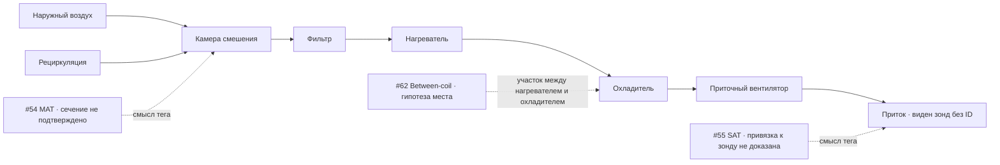

# RBC‑Nesbitt AHU2 · физический тракт и доказательства привязки

## Известно из источника

Оригинальный `00_explanations.pdf`, стр. 4, Fig. 1, показывает порядок аппаратов в направлении притока. Перед нагревателем есть фильтр. После вентилятора виден зонд без ID. Изображение не даёт ID зонда между теплообменниками и не привязывает #55 к видимому зонду. Стр. 3 характеризует схему как конфигурацию реальной установки Nesbitt Hall. Номера # здесь означают **позиции колонок с единицы**, а не номера аналоговых входов. [Релиз издателя](https://doi.org/10.6084/m9.figshare.29297999.v3)

Сплошные стрелки задают направление воздуха по рисунку. Пунктирные связи обозначают предполагаемую привязку заголовка. На рисунке не добавлен физический датчик для #62 или #54.

## Проверка словарей и первичных материалов

| Источник | Что подтверждает | Граница доказательства |
|---|---|---|
| Оригинальные заголовки 20170714 и 20170729 | #54 Mixed Air, #55 Supply Air, #56 Supply Fan Speed, #58 Cooling Coil Valve Position Feedback, #62 Between-coil, #7 Chilled Water Flowrate, #72/#73 Steam Valve Control. Подлинные строки и единицы в CSV матрице и JSON квитанции. | Заголовок и номер колонки не идентифицируют аппаратный вход или место установки. |
| `FeaturesNames.xls`, Sheet1, строки 7–10, и `conventions.pdf` | Словарь различает `MA-TEMP`, `HWC-DAT` (выход нагревателя), `CHWC-DAT` (выход охладителя) и `SA-TEMP`. | Связка #62 с любым из кодов, адресом BAS и датчиком не найдена. |
| Chen, диссертация, 2019, §3.5.5.3, Table 3-6 | Публично индексируемый фрагмент перечисляет Between-coil среди архивируемых BAS величин и chilled-water flow в группе chiller. | Карточка репозитория открылась через индекс, прямая полная версия в этой сессии недоступна. По доступному фрагменту соответствие аппаратным входам не установлено. [Репозиторий Drexel](https://researchdiscovery.drexel.edu/esploro/outputs/doctoral/Data-driven-whole-building-fault-detection-and/991014632152104721) |
| Chen & Wen, 2018, Fig. 4 | Один chiller и разветвление CHW к трём AHU. | Общая гидравлика показана без измерительного прибора на ветви AHU2. [Первичная публикация PHM](https://doi.org/10.36001/phmconf.2018.v10i1.517) |
| Chen et al., 2020, Table 1 | Исходное имя BAS `chws_control/chw_flow` дано для расходомера группы Chiller. Остальные приведённые AHU имена в таблице относятся к AHU1. | Нет crosswalk имени `chws_control/chw_flow` к #7 в этих двух CSV и нет пары аппаратных входов для AHU2 #62/#55. [Первичная публикация, таблица 1](https://www.mdpi.com/1424-8220/20/20/5947/pdf?version=1603277372) |

Поиск целенаправленно включал «Nesbitt Hall AHU2 I/O», «Between-coil BAS trend_log», «BACnet point schedule» и первичные отчёты Drexel и DOE. Публичного документа с двумя аппаратными адресами и монтажными сечениями не найдено в проверенных источниках. Это граница поиска, а не утверждение об отсутствии записи у владельца BAS.

## Номинальные значения и интерпретация

| Ранее открытый день | Валидные тройки | #62 ≠ #55 | #62 = #54 | Медиана #62 − #55, °F | Медиана #62 − #54, °F |
|---|---:|---:|---:|---:|---:|
| 2017‑07‑14 | 288 | 288 | 118 | 10,85 | 0,0 |
| 2017‑07‑29 | 288 | 286 | 92 | 9,0 | −0,1 |

**Измерено в опубликованной записи:** 574/576 различных значений #62 и #55 исключают точное совпадение этих двух архивных рядов. Это не независимая проверка датчиков. Не проверены общий первичный источник с обработкой, масштабом или задержкой, фактическое сечение, аппаратная независимость, калибровка и синхронизация.

**Предполагается:** если имя #62 отражает расположение между показанными теплообменниками, точка находится до охлаждения. При этой гипотезе MAT − #62 не охватывает охладитель. Ветка, называющая #62 выходом охладителя, имеет `LOCATION_CONFLICT` с такой трактовкой схемы, а сам тег имеет `SCHEMATICALLY_PLAUSIBLE` только для промежуточного сечения. `I_O_MAPPED` означает проверенный crosswalk колонки, регистра и физического ввода. `INDEPENDENCE_VERIFIED` дополнительно требует раздельных первичных датчиков. Эти два статуса здесь не присвоены. `NAME_ONLY` относится к роли по заголовку без доказательства физической точки.

**Пока не допущено:** условное `T_between − T_SAT` характеризовало бы весь участок между сечениями, включая охладитель, нагрев воздуха вентилятором и теплоприток в воздуховоде. Разность °F переводится в K умножением на 5/9. Нужны run-proof или проверенный наблюдатель, синхронный воздушный поток, известный режим нагрева и физической подачи холода, проверка инерции и задержек, калибровка и неопределённость пары. При неизвестном режиме трактовка `INCONCLUSIVE`. SAT участвует в обратной связи, поэтому SAT−SP, SAT и зависимая от него команда не являются независимыми доказательствами. Переименование SAT не добавляет датчика.

**Разделение вмешательств:** паспорт стр. 2–3 описывает RBC AHU2 overrides на 100% и 80% открытие. Это не G36-сценарий заданного закрытия. Метки не объединены. #7 оставлен plant-контекстом. #56 — скорость по заголовку, без подтверждённого run-proof. #58 — опубликованный feedback, без гарантии расхода или идентификации механизма. #72/#73 — команды, без подтверждения физического теплопереноса.

Реестр экспозиции в `RBC_EXPOSURE_LEDGER_G5_6.csv`. Текущая проверка прочла числовые значения только двух ранее открытых номинальных дней. Исторические RBC-срезы и holdout исключены из кандидатов на слепую кампанию. Ни порог, ни результативность метода не оценивались.
